# VLVI-HAF Prediction System V1.0

> **Reviewer note on setup time.** Provided the hardware meets the requirements
> in Section 1, the complete environment setup can be finished within a single
> working day. Downloading SLN_Prediction.zip, SLN_Prediction.z01, and SLN_Prediction.z02, 
> extracting SLN_Prediction.zip, and completing a first prediction on the bundled sample 
> studies takes well under an hour.

The application estimates the probability that a newly diagnosed breast cancer
patient has sentinel lymph node (SLN) metastasis. It wraps the VLVI-HAF (Virtual LVI-informed 
hierarchical attention fusion) model, which adopts a cascaded prediction strategy. Firstly, the fusion of MRI, 
mammography, and ultrasound imaging modalities with 12 clinical features is used to predict LVI (Lymphovascular invasion). The predicted LVI is added to the original features to further predict SLN metastasis.

---

## Contents

| Item | Description |
|---|---|
| `SLN_Prediction.z01` | Portable Windows x64 application, Volume 1 of 3, 1 GB |
| `SLN_Prediction.z02` | Portable Windows x64 application, Volume 2 of 3, 1 GB |
| `SLN_Prediction.zip` | Portable Windows x64 application, Volume 3 of 3, 657 MiB |
| `Test_data.zip`  | Two compressed test samples that have been de-identified, 341 MiB |
| `VLVI_HAF_Prediction_System_README.md` | This guide |

The archive is self-contained. Python, PyTorch and the model weights do not need
to be installed separately.

**Release file:** download from the [Releases](../../releases) page.

| Property | Value |
|---|---|
| File name | `SLN_Prediction.z01` |
| Size | 1,073,741,824 bytes (1 GB) |
| SHA-256 | `DCAB2A002F3E18AE85D271B8EE58E8E3BCD6F5AD5C838A6B64AAD6D5A6220D71` |
|---|---|
| File name | `SLN_Prediction.z02` |
| Size | 1,073,741,824 bytes (1 GB) |
| SHA-256 | `423768647A73B63F9F25B1851DD336FA8B4149DEB1673AF015F2A7A5E23E2A83` |
|---|---|
| File name | `SLN_Prediction.zip` |
| Size | 688,396,430 bytes (657 MiB) |
| SHA-256 | `0F6BF94F7749F96C14BA1CB2B4AE8007E378341426BC1848E949A5AC673EEB60` |
|---|---|
| File name | `Test_data.zip` |
| Size | 358,462,560 bytes (341 MiB) |
| SHA-256 | `8BDF941D2F4A12498DCAB45FD5915BC5DA29E8770C5E635ED955840B259E3EB1` |

---

## 1. System Requirements

| Item | Requirement |
|---|---|
| Operating system | Windows 10 or Windows 11, 64-bit |
| Architecture | x86-64 (x64). Windows on ARM is supported through x64 emulation |
| Memory | 8 GB minimum, 16 GB recommended |
| Free disk space | 5 GB (the archive plus the extracted folder) |
| Runtime | Microsoft Visual C++ 2015-2022 Redistributable (x64) |
| Display | 1280 x 800 or larger |

This release provides the Windows build. A macOS build is available from the
authors on request.

---

## 2. Download and Verify

1. Open the **Releases** page of this repository.
2. Download `SLN_Prediction.z01`, `SLN_Prediction.z02`, `SLN_Prediction.zip`, `Test_data.zip`.
3. Optionally verify the download before running it, in PowerShell:

```powershell
Get-FileHash -Algorithm SHA256 ".\SLN_Prediction.z01"
Get-FileHash -Algorithm SHA256 ".\SLN_Prediction.z02"
Get-FileHash -Algorithm SHA256 ".\SLN_Prediction.zip"
Get-FileHash -Algorithm SHA256 ".\Test_data.zip"
```

The hash must match.

`DCAB2A002F3E18AE85D271B8EE58E8E3BCD6F5AD5C838A6B64AAD6D5A6220D71` for `SLN_Prediction.z01`.

`423768647A73B63F9F25B1851DD336FA8B4149DEB1673AF015F2A7A5E23E2A83` for `SLN_Prediction.z02`.

`0F6BF94F7749F96C14BA1CB2B4AE8007E378341426BC1848E949A5AC673EEB60` for `SLN_Prediction.zip`.

`8BDF941D2F4A12498DCAB45FD5915BC5DA29E8770C5E635ED955840B259E3EB1` for `Test_data.zip`.

4. Extract the archive to a local folder, for example `D:\SLN_Prediction`
   and `D:\test_data`. Do not run the application from inside the ZIP file.

After extraction you should see:

```
SLN_Prediction/
├── SLN_Prediction.exe
└── _internal/

test_data/
├── MR+MG/
├── US/
├── case1_Clinical_info.csv
└── case2_Clinical_info.csv
```

The `_internal` folder holds the runtime, the encrypted model asset and the Qt
libraries. Keep it next to the `.exe`. Copying only the `.exe` will not work.

---

## 3. Launch

Double-click `SLN_Prediction.exe`.

The first start takes 10 to 30 seconds while the runtime initialises.

---

## 4. Input Data

A prediction requires all six image views with manually delineated masks, plus
the clinical fields.

### 4.1 Patient folder layout (NIfTI input)

```

test_data/
├── MR+MG/
│   └── ID/
|       ├── MG/
|       |   ├── {ID}_MG_*CC*.nii[.gz]        
│       │   ├── {ID}_MG_*CC*_GTV.nii[.gz]    
│       │   ├── {ID}_MG_*MLO*.nii[.gz]       
│       │   ├── {ID}_MG_*MLO*_GTV.nii[.gz]   
│       │   └── {ID}_MG_*MLO*_GTVnd1.nii[.gz]
│       │
│       ├── {ID}_DCE_GTV.nii[.gz]
│       ├── {ID}_DCE_GTVnd1.nii[.gz]
│       ├── {ID}_DCE_N4.nii[.gz] 
│       ├── {ID}_DWI.nii[.gz]       
│       ├── {ID}_DWI_GTV.nii[.gz]   
│       └── {ID}_DWI_GTVnd1.nii[.gz]
│   
├── US/
│   └── ID/
│      ├── {ID}_H.nii[.gz]
│      ├── {ID}_H_GTV.nii[.gz]
│      ├── {ID}_V.nii[.gz]
│      └── {ID}_V_GTV.nii[.gz]
└── {ID}_Clinical_info.csv

```

nii.gz is image data; GTV.nii.gz is the data of the tumor ROI delineation area; GTVnd1.nii.gz is 
the data for delineating the ROI area of sentinel lymph nodes; N4.nii.gz is the N4 corrected data.

### 4.2 Clinical CSV file

One CSV file holds one row per patient. The first non-empty row is the header; 
the application matches the image folder name to the ID column. Leading zeros 
and punctuation differences are tolerated; ambiguous matches are rejected rather than guessed.

### 4.3 Bundled sample studies

Two de-identified example cases are included in `test_data/` so the software
can be exercised without collecting new cases. For example, in `case1_Clinical_info.csv`


| ID | Laterality | Multifocality(Tumor number) | Age | Location(nine) | Tumor size US length | Tumor size US width | Tumor size MG | Tumor size MRI | cT | Axillary US | Calcification | Breast density | SLN(Positive or Negative) |
|---|---|---|---|---|---|---|---|---|---|---|---|---|---|
| `case1` | Left | Unifocal    | 45    | UIQ    | 1.7  | 1.1  | 2.1   | 2    | T1    | Negative | No    | C    | Positive |


Each case already contains all six image views, and their corresponding `GTV`, `GTVnd1` 
and its own clinical CSV file. SLN(Positive or Negative) is the target variable. The CSV files carry the full clinical fields.

---


## 5. Operation process

1. **Data configuration**:

   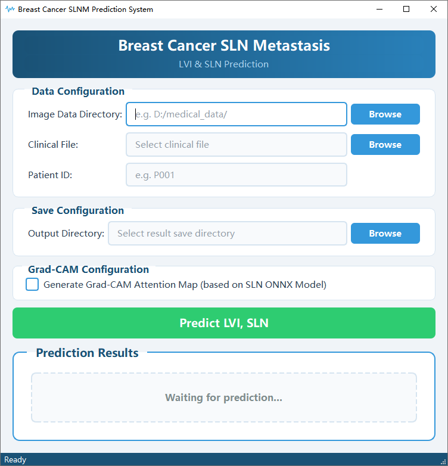

   *Image data directory*: Configure the image data directory for US, MG, and MRI input, with the data format being NIfTI. As `test_data/`.

   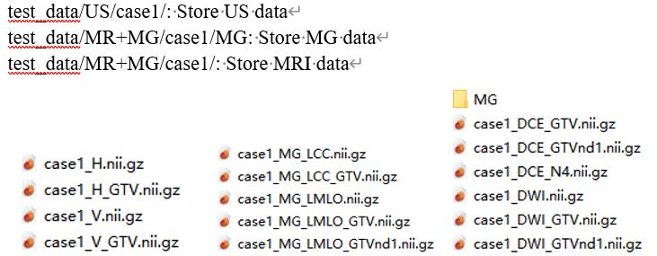

   *Clinical file*: Configure the clinical file path, which includes information such as age and tumor size. 
   For example, `test_data/case1_Clinical_info.csv`. 

   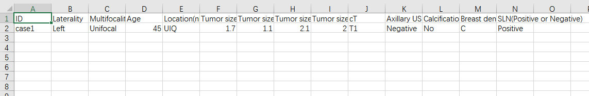

   *Patient ID*: For example, `case1`.

2. **Save configuration**: Output directory for results, e.g. `test_results/`.

3. **Grad-CAM configuration**: Check the box to determine whether to output image data Grad-CAM attention maps.

4. **Predict LVI, SLN**: Prediction button, Click the button and wait for the output result.

   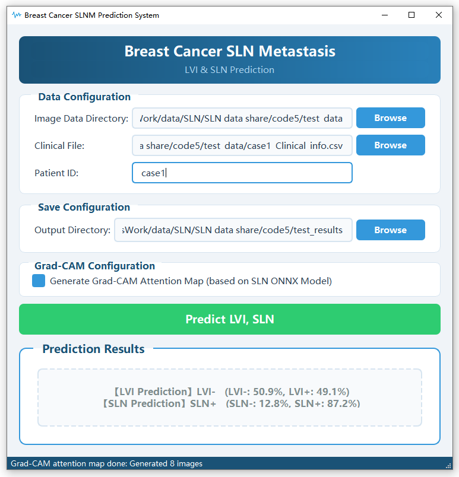

## 6. Read the result

After the prediction is completed, generate the patient's prediction 
result directory under the output directory results/: `test_results/case1/`. 
Prediction result file: `prediction_result.txt`, which contains LVI and SLN prediction probabilities.  

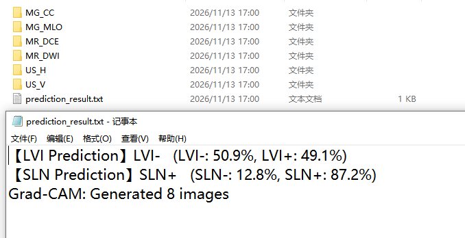

If the Grad-CAM Attention Map option is checked, the Grad-CAM Attention Map of the three modal images 
will be generated additionally in `test_results/case1/US_H/`, `test_results/case1/US_V/`,`test_results/case1/MG_CC/`, `test_results/case1/MG_MLO/`, `test_results/case1/MR_DCE/`, `test_results/case1/MR_DWI/`.


| US_H | US_V |
|---|---|
| 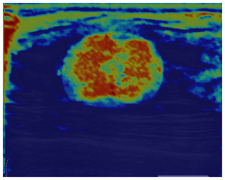 | 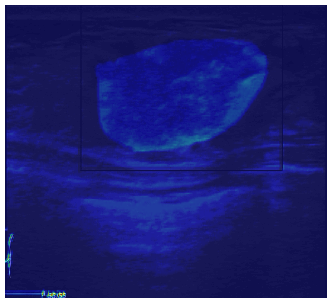 |

| MG_CC | MG_MLO |
|---|---|
| 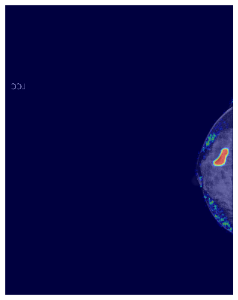 | 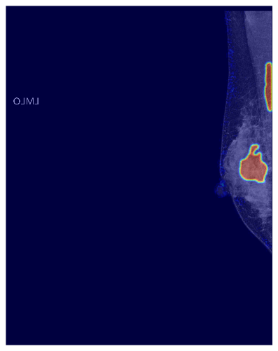 |

| DCE sagittal | DCE transverse |
|---|---|
|  | 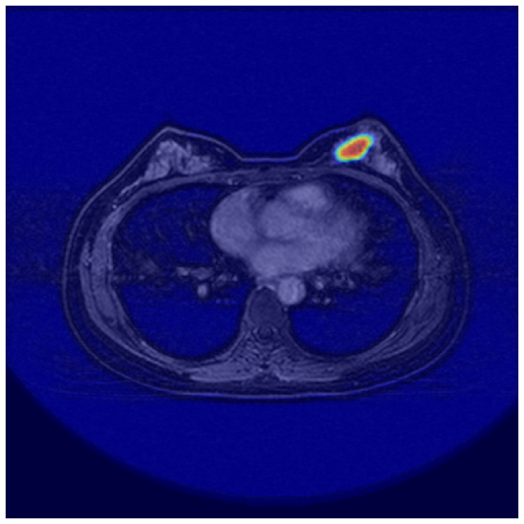 |

| DWI sagittal | DWI transverse |
|---|---|
|  | 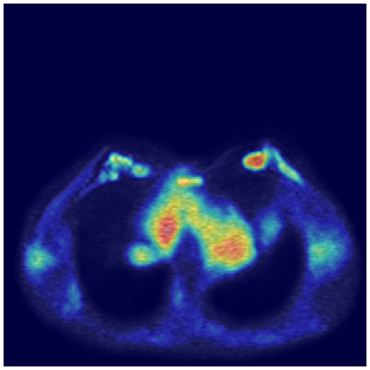 |


The Grad-CAM attention map here is generated based on ONNX model weights. 
Due to differences in operator implementation and gradient calculation 
between ONNX and PyTorch, the model converted by onnx2torch may introduce 
certain errors during backpropagation, resulting in slightly lower spatial 
localization accuracy of the attention map compared to directly using .pth 
model weights. This limitation mainly affects the visualization effect and 
does not affect the predictive performance of the model itself.

---

## 7. Intended Use and Limitations 

This tool is intended for academic and research use only. It is not a medical
device, has not been cleared or approved by any regulatory body, and must not be
used as a substitute for clinical judgement. Predictions are model estimates
derived from a breast cancer cohort and may not apply to an individual patient.
All output should be interpreted by a licensed clinician.

The studies under `test_data/` are de-identified research examples shared so
that the software can be reproduced. They carry a study identifier, image
volumes, contours and the clinical panel only. They contain no
name, hospital number, medical record number, date of birth or acquisition date.
They are provided for software verification and method reproduction, not for
clinical use or for re-identification.

---

## 8. Distribution

This repository distributes a compiled binary for peer review. Source code is
not included, and no licence to modify, redistribute, sublicense or incorporate
the software into another product is granted. All rights remain with the
authors.

For questions about the manuscript, the model, or access to a macOS build,
contact the corresponding author through the journal's editorial system.
